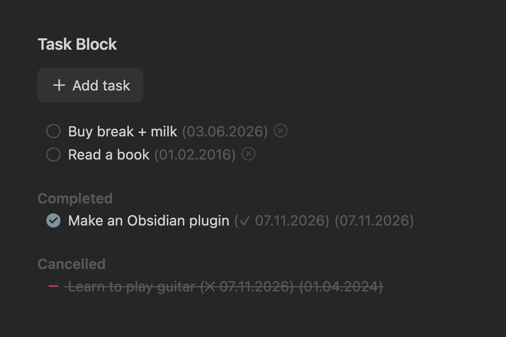

# Task Block

[Obsidian](https://obsidian.md) plugin that manages blocks of tasks/todos that stay very organized.

## Features

- Task blocks wrapped in `%% tasks %%` … `%% /tasks %%`
- Sorts automatically: open tasks first, then completed, then cancelled, with optional section titles
- Adds created, completion and cancelled dates as inline fields (`[created:: 2026-11-07]`), shown in a format you choose. Select a date to edit it
- **Add task** button and an optional cancel button on open tasks
- Enter on a task creates a new dated task below it
- Statuses: open, in progress (`/`), complete, cancelled (`-`)
- Works in live preview and reading view

## Usage

- Insert a block with the **Insert task list** command or from the editor context menu
- Override labels per block in its opening marker: `%% tasks button: Add item completed: Bought cancelled: Skipped %%`. Each is optional
- Add tasks with the button, the **Add task** command, or Enter on an existing task
- Change status by ticking the checkbox, from the context menu, or with the **Mark as …** commands
- Configure it in **Settings → Task Block**: date format, button text, cancel button, section titles
- Configure per-block labels in the opening `%% tasks %%` tag. For example, `%% tasks button: Add item completed: Bought cancelled: Not needed %%` for a shopping list

## How it works

- Tasks are plain Markdown checkboxes. Dates are stored as inline fields: `[created:: …]`, `[completion:: …]`, `[cancelled:: …]`
- Sorting and date stamps are written to the note itself, so the file stays organized without the plugin
- Notes that change while not open in an editor (reading view, sync, other plugins) are re-sorted in the background
- No network access; nothing leaves your vault

## Installation

1. Open **Settings → Community plugins** and select **Browse**
2. Search for **Task Block**, then select **Install**
3. Select **Enable**
